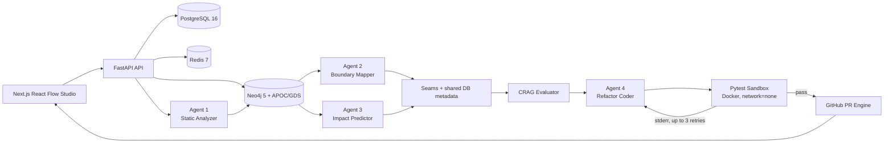

# C.O.R.E.

**Codebase Orchestration & Refactoring Engine** is a FastAPI + Next.js
workspace for identifying safe microservice seams in Python monoliths and
verifying generated extractions before review. The MVP uses PostgreSQL for
workspace/job state, Neo4j for the tenant-scoped code graph and embeddings,
Redis for queues/cache/events, and Clerk for API/browser authentication.

## Architecture



The backend applies `alembic upgrade head` before Uvicorn starts. Compose waits
for PostgreSQL, Neo4j, Redis, and the prebuilt sandbox image healthchecks before
starting the API; the frontend waits for the API healthcheck. The sandbox image
is built from `backend/sandbox.Dockerfile` and is invoked through the Docker
socket with bounded memory, CPU, PID, output, and timeout settings.

## Feature walkthrough

1. **Ingest a repository.** Submit a public GitHub URL or choose the built-in
   `sample_monolith`. Agent 1 parses Python with Tree-sitter, creates stable
   Neo4j nodes/relationships, and records progress in PostgreSQL/Redis.
2. **Map extraction seams.** Agent 2 runs Neo4j GDS Louvain when available and
   a deterministic NetworkX fallback otherwise. The graph studio shows
   communities, cohesion/coupling, and shared read/write database tables.
3. **Simulate blast radius.** Select a function or class and request one to
   five caller hops. Agent 3 returns affected symbols/routes/tables and an
   explained 0–100 structural risk score.
4. **Verify a migration.** The LangGraph workflow retrieves seam context,
   evaluates CRAG completeness, generates a FastAPI service/adapter/proxy,
   runs pytest in the isolated sandbox, retries failures up to three times, and
   can publish a verified GitHub pull request.

## Quickstart with Docker Compose

The following commands create local-only passwords and a Fernet key in an
ignored `.env` file. They do not create or commit production credentials.

```bash
cp .env.example .env
python - <<'PY'
import base64
import re
import secrets
from pathlib import Path
from urllib.parse import quote

env_path = Path(".env")
text = env_path.read_text(encoding="utf-8")
postgres_password = secrets.token_urlsafe(24)
neo4j_password = secrets.token_urlsafe(24)
fernet_key = base64.urlsafe_b64encode(secrets.token_bytes(32)).decode()
docker_socket = Path("/var/run/docker.sock")
docker_gid = str(docker_socket.stat().st_gid) if docker_socket.exists() else "0"
replacements = {
    "POSTGRES_PASSWORD": postgres_password,
    "NEO4J_PASSWORD": neo4j_password,
    "DATABASE_URL": (
        "postgresql+asyncpg://core_user:"
        f"{quote(postgres_password, safe='')}@postgres:5432/core_db"
    ),
    "ENCRYPTION_SECRET_KEY": fernet_key,
    "DOCKER_GID": docker_gid,
}
for key, value in replacements.items():
    text = re.sub(rf"^{re.escape(key)}=.*$", f"{key}={value}", text, flags=re.MULTILINE)
env_path.write_text(text, encoding="utf-8")
PY

# Set OPENAI_API_KEY in .env before requesting ingestion or seam names.
docker compose up --build
```

Open `http://localhost:3000` for the frontend and
`http://localhost:8000/api/v1/health` for the unauthenticated dependency
healthcheck. The Compose stack binds PostgreSQL, Neo4j, and Redis to loopback
only. `DOCKER_SOCKET_PATH` and `DOCKER_GID` in `.env` control how the backend
reaches the host Docker engine for sandbox runs; on Linux, set `DOCKER_GID` to
the group ID of `/var/run/docker.sock` when the default `0` is insufficient.

Clerk keys are required for authenticated browser/API flows. `OPENAI_API_KEY`
is required for real embedding and LLM naming calls; the application reports
missing provider configuration instead of fabricating vectors or names.

To stop the stack and remove its local volumes:

```bash
docker compose down -v
```

## Local verification

Portable deployment checks run without a Docker daemon:

```bash
python scripts/validate_deployment.py
ruff check backend sample_monolith
ruff format --check backend sample_monolith
PYTHONPATH=. pytest sample_monolith backend/tests
```

Frontend checks run from `frontend/`:

```bash
npm ci
npm run typecheck
npm run lint
npm test
npm run test:smoke
npm run build
```

Docker is unavailable in the current coding environment: the Docker CLI and
daemon are not installed, so
`docker compose config`, image builds, cold-start migrations, and live Compose
healthchecks are intentionally not claimed as locally verified. CI runs the
Compose static configuration check and builds the backend, frontend, and
sandbox images on Ubuntu runners.
